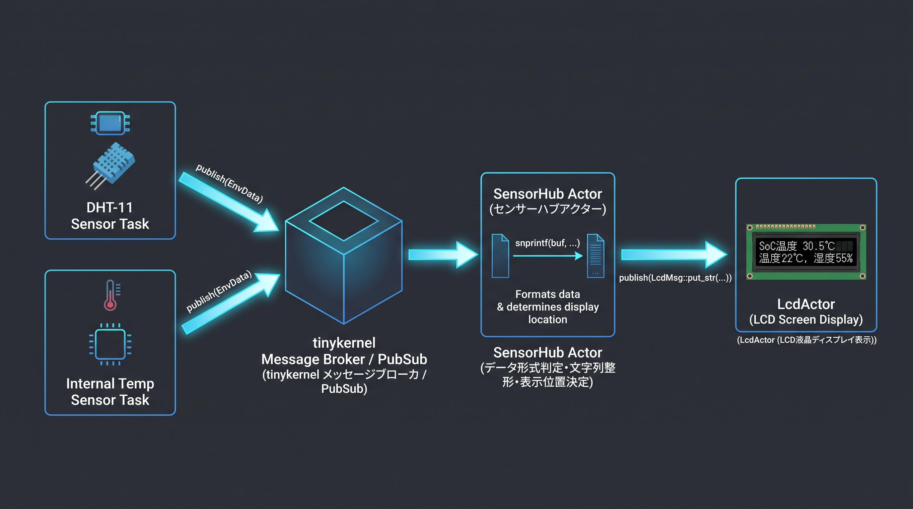
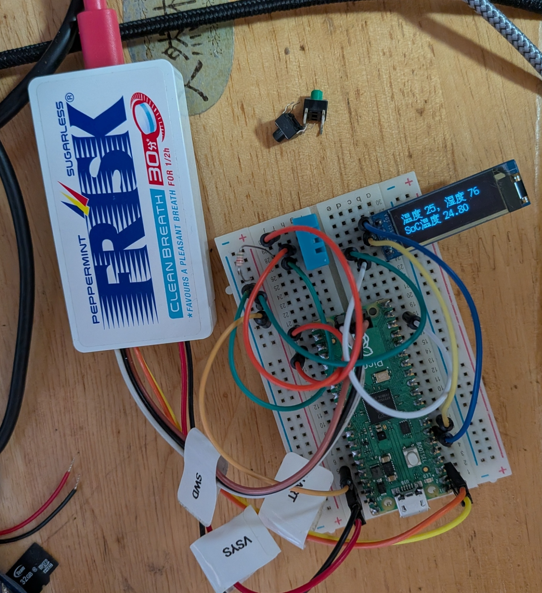

# tinykernelサンプル～DMA/PIO/Pub/Subを活用した温湿度センサー表示例

(English version follows the Japanese section)

オリジナルのRaspberry Pi Pico2（RP2350）向けプリエンプティブマルチタスクカーネル[tinykernel](https://github.com/satoyon/tinykernel)の利用例として温湿度センサーDHT-11と内部温度センサーの値をSSD1306で表示するサンプルを作成しました。

## 特徴

- tinykernelのPub/Subメッセージングシステムを活用した完全疎結合アーキテクチャ
- tinykernelにおけるRP2350のDMAおよびPIOの併用事例になっています
- オブジェクト指向を徹底しつつ使用リソースを抑えた組み込み向きのコード設計

## コードの説明

### dht11_sensor.hpp/dht11_sensor.cpp

DHT-11センサータスク。DHT-11からのデータの読み取りをPIOで行い、PIOのデータ転送にDMAを使用しています。DMA完了待ちにはセマフォ（`tk::BinarySemaphore`）を活用し、他のタスクにCPUを移譲します。また、センサータスクは、センサーメッセージを`tk::publish()`で投げることに専念し、それ以外の処理を排除することで独立性を高めています。

### intl_sensor.hpp/intl_snesor.cpp

内部温度センサータスク。ADCを読み取り温度に変換して`tk::publish()`します。シンプルなセンサータスクの実装例になっています。

### SensorHub.hpp/sensor_msg.hpp

センサーメッセージの定義に`std::variant`を利用して一種の多相化を行い、センサーデータを集約する`SensorHub`クラスを実装しました。センサーメッセージのペイロードは任意の型を取れるので、さまざまなセンサーに対応できます。なおかつ、処理が重くなる継承などのメカニズムを利用せず、データのやり取りはスタックのみで完結します。

`SensorHub`クラスは各センサータスクからセンサーデータを受け取り、加工して別のオブジェクトに`tk::publish()`します。このような設計にすることで、任意にセンサータスクを増やしたり、あるいはセンサーデータを記録するActorを追加するといった拡張が自在に行えます。このサンプルにおいては、表示文字列として加工し`lcd_actor`に`tk::publish()`しています。

## 実行例

サンプルを実行するには、DHT-11とSSD1306を使用した128×32ドットのOLEDモジュールが必要です。次のようにPico 2とデバイスを接続してください。

| GPIO | デバイス |
| ---- | ---------- |
| GP4 | SSD1306 SDA |
| GP5 | SSD1306 SCL |
| GP16 | DHT-11 SDA |

---

## tinykernel Sample: Temperature & Humidity Sensor Display using DMA, PIO, and Pub/Sub

This repository contains a sample application for [tinykernel](https://github.com/satoyon/tinykernel), an original preemptive multitasking kernel designed for the Raspberry Pi Pico 2 (RP2350). This sample demonstrates reading data from a DHT-11 sensor and the internal temperature sensor, then displaying the values on an SSD1306 OLED display.

## Features

- **Decoupled Architecture:** Leverages tinykernel's Pub/Sub messaging system to ensure high modularity between tasks.
- **Hardware Optimization:** Demonstrates efficient simultaneous use of DMA and PIO on the RP2350 within a kernel environment.
- **Embedded-Optimized Design:** Implements object-oriented principles while maintaining minimal resource overhead, ideal for constrained embedded systems.

## Code Implementation Details

### `dht11_sensor.hpp / .cpp`

The DHT-11 sensor task. It uses PIO for data acquisition and DMA for efficient data transfer. To maximize CPU efficiency, a semaphore (`tk::BinarySemaphore`) is used to wait for DMA completion, allowing the scheduler to hand over the CPU to other tasks. The task follows a "fire-and-forget" approach by using `tk::publish()` to broadcast sensor messages, ensuring high independence from other modules.

### `intl_sensor.hpp / .cpp`

The internal temperature sensor task. It reads the ADC, converts the raw data into temperature values, and publishes them via `tk::publish()`. This serves as a simple example of a standard sensor task implementation.

### `SensorHub.hpp / sensor_msg.hpp`

The data aggregation layer. It utilizes `std::variant` to achieve a form of polymorphism for sensor messages without the overhead of traditional inheritance-based polymorphism. This allows the message payload to support various data types while keeping data exchange strictly stack-based and lightweight.

The `SensorHub` class receives data from multiple sensor tasks, processes it, and publishes the results via `tk::publish()`. This architecture is highly scalable; you can easily add new sensor tasks or introduce an "Actor" task for data logging without modifying existing logic. In this sample, it formats the data into strings and publishes them to the `lcd_actor`.

## Hardware Setup & Execution

To run this sample, you will need a DHT-11 sensor and an SSD1306 128×32 OLED module. Connect them to the Raspberry Pi Pico 2 as follows:

| GPIO | Device |
| ---- | ------ |
| GP4  | SSD1306 SDA |
| GP5  | SSD1306 SCL |
| GP16 | DHT-11 SDA |
